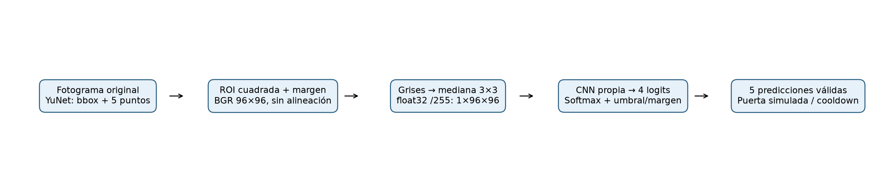

# Resultados de los modelos seleccionados

| Modelo | Procedencia | Accuracy | Macro F1 | FAR | FRR |
|---|---|---:|---:|---:|---:|
| R02 Flatten | Test reservado:322 imágenes |92,24 %|0,925665|2/142=1,41 %|30/180=16,67 %|
| R03-B Flatten | Validación:302 imágenes |98,01 %|0,981435|1/122=0,82 %|11/180=6,11 %|

R02 se seleccionó/calibró con val antes de evaluar test una sola vez. Su accuracy
tras la regla fue90,06 %; aceptaciones correctas por persona54/60,55/60,41/60.
El FAR final superó el objetivo empírico1 %: no se recalibró después.

R03-B fue elegido con val entre más datos/aumentos/regularización, manteniendo
la misma validación R02. En esa val acepta51/60,60/60,58/60; R02 val aceptaba
44/60,58/60,45/60. Umbrales globales congelados: R02=0.9197969436645508 y
R03-B=0.9813899397850037; margen0,15. No hay reglas por persona.

No comparar R02 test contra R03-B val como prueba de superioridad de generalización.
R03-B aún necesita un nuevo test independiente. Una semilla y una sesión val
reutilizada no prueban significación estadística ni ausencia de sobreajuste.
Más imágenes y afines/contraste se asociaron con mejoras en desarrollo; no se
aisló causalmente cada aumento ni se demostró robustez al peinado.

El usuario comunicó pruebas presenciales satisfactorias con tres personas; no
se inventan números de intentos o FAR presencial. La prueba externa de otra
computadora continúa pendiente. Distancia, encuadre, luz y apariencia pueden
afectar; ninguna causa específica se atribuye sin un ensayo controlado.

YuNet es un detector externo preentrenado, no el clasificador de identidades.
Ambos clasificadores propios tienen1.272.644 parámetros para tres autorizados y
Desconocido. El formato original no cambia al importar localmente: se comprueba
equivalencia CPU de tensores/logits/probabilidades sobre entradas sintéticas.

Sin detección de vida y con una puerta simulada. Scores Softmax no son prueba
de identidad ni una garantía de rechazo de desconocidos universales. Los cinco
fotogramas consecutivos están correlacionados: no elevar FAR a una potencia.
